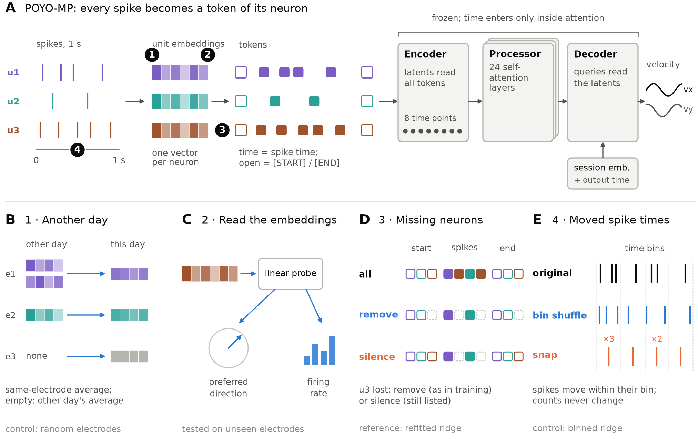
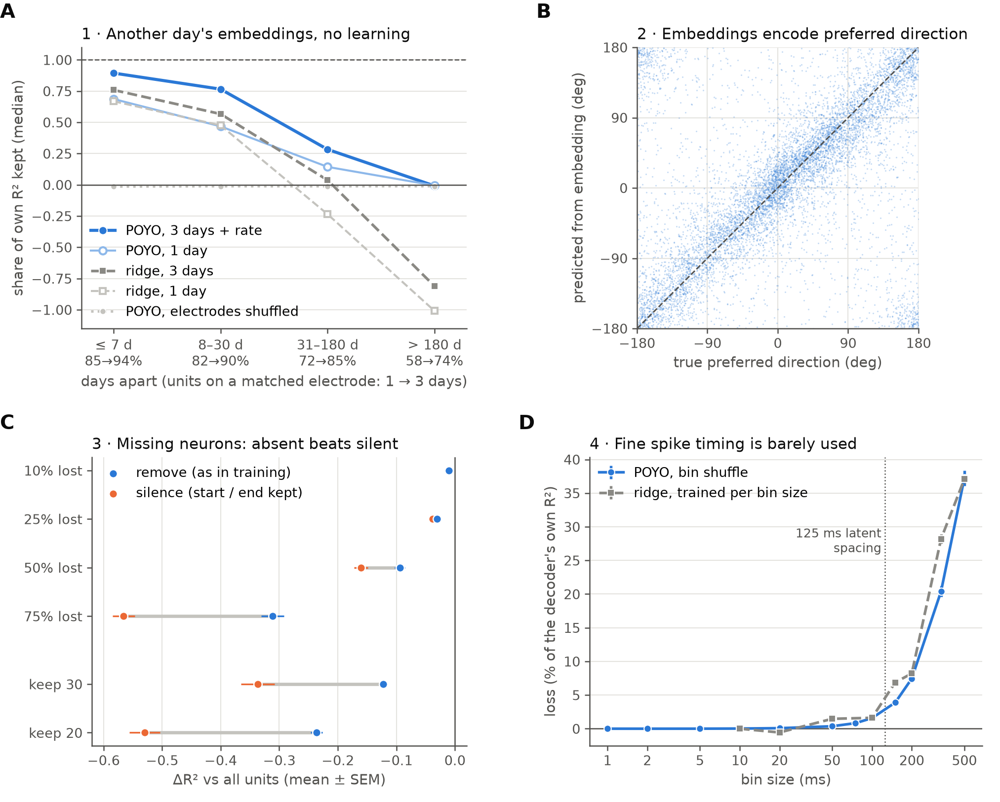

# what-poyo-learns

POYO (Azabou et al., NeurIPS 2023) decodes behaviour from neural populations by turning every
spike into a token made of a learned unit embedding and an exact spike time. This repository asks
what the public **POYO-MP** checkpoint learns about individual neurons, and whether that knowledge
can be reused on another recording day, using 99 sessions of monkey motor-cortex recordings and
**without retraining the model**: only its test inputs are changed, or its learned weights read
or swapped between days.

Full methods, results, design decisions and limitations: the paper, **[main.tex](main.tex)**.



*POYO-MP turns every spike into a token of its neuron (A); the four analyses (B–E) swap, read or
remove those tokens' embeddings, or move their times. Numbers 1–4 match the findings below.*

## Key findings

1. **Another day's embeddings decode a session, with no learning.** Giving each unit the
   embedding of the same electrode on the nearest other day keeps a median 71% of R²; random
   electrodes keep 0%, and the session embedding barely matters. Pooling the three nearest days
   and, on each electrode, picking the unit with the most similar firing rate (no behaviour labels
   needed) raises this to 91%. A fixed linear decoder averaged over the same three days keeps 75%.
   Transfer fades over months and is gone after half a year. (A simulated new day: the sessions
   were in training, and this does not test whether multi-session training helps.)
2. **The embeddings describe each neuron.** On held-out electrodes, a linear probe recovers
   preferred direction (median error 21.5°) and firing rate (R² 0.56), almost entirely as
   differences between neurons of the same session, and units on the same electrode look alike
   across days, consistent with the transfer. The model is never given any of this. The embeddings
   also fit a small shared code: the nearest of 256 codes learned from other sessions keeps 86% of
   R², 16 shared principal axes keep 96%, and across monkeys the axes carry over (88%) while the
   codes do not (9%).
3. **When neurons go missing, absent beats silent.** Leaving a lost unit out, as POYO's training
   augmentation does, costs far less than feeding it as silent (75% of units lost: ΔR² −0.31 vs
   −0.57). Without any retraining, POYO loses less of its accuracy than a linear decoder refitted on
   the remaining units.
4. **Fine spike timing is barely used.** Moving or shuffling spikes within 20 ms costs < 0.001 R²,
   within 50 ms < 0.005 R². Performance breaks down only at 100–333 ms bins, and a binned linear
   decoder shows the same breakdown. 



All results come from one checkpoint and test-time manipulations; see the limitations in
the paper ([main.tex](main.tex)).

## Repository layout

| Path | Content |
|---|---|
| `main.tex` | The paper (LaTeX): methods, results, appendix; figures from `figures/` |
| `src/` | Analysis code: spike-timing perturbations, evaluation harness, statistics, ridge control, unit properties, embedding probes, lesions, embedding swaps, codebooks (neuron letters) |
| `scripts/setup/`, `timing/`, `embeddings/`, `lesions/`, `transfer/`, `codebook/` | Runners and analyses for each part of the study |
| `scripts/audit/` | Independent cross-checks of the published results |
| `scripts/docs/` | Draws the paper's figures in one shared style |
| `tests/` | Tests |
| `results/` | Every result table (files listed below) |
| `figures/` | Paper figures, named by figure number |
| `reproduce.sh` | Re-runs every analysis, figure and check (see Reproduce) |
| `environment.yml`, `pip_freeze.txt` | Pinned environment (`pip_freeze.txt`: exact versions of every package) |

No library code is modified; the project only calls `torch_brain` (cloned into `external/`, see
Setup).

## Setup

Requires conda; a CUDA GPU is needed only for the timing sweep, the lesion study and the embedding
swaps.

```bash
conda env create -f environment.yml && conda activate f_models      # exact pins: pip_freeze.txt
git clone --branch v0.2.0 https://github.com/neuro-galaxy/torch_brain.git external/torch_brain_v0.2.0
brainsets config set --raw-dir data/raw --processed-dir data/processed
brainsets prepare perich_miller_population_2018
mkdir -p checkpoints && curl -o checkpoints/poyo_mp.ckpt \
    https://torch-brain.s3.amazonaws.com/model-zoo/poyo_mp.ckpt
echo "8cd2796d75231c8474347e6a3cb02692978c44b9b7a165761ad6cce3c529d42a  checkpoints/poyo_mp.ckpt" | sha256sum -c
```

`external/torch_brain_v0.2.0/` must be an unmodified checkout of the `v0.2.0` tag (`bd46a57`); only
its `examples/poyo/` is used, because it is not shipped in the pip wheel.

## Reproduce

After the setup above, check the published results without re-running the experiments:

```bash
bash reproduce.sh check
```

Re-run everything from scratch (about 15 h, mostly GPU; every long run resumes where it stopped):

```bash
bash reproduce.sh all        # or one part: timing | embeddings | lesions | transfer | codebook | figures
```

`bash reproduce.sh --dry-run all` prints every command without running it.


## Acknowledgements

- POYO: Azabou et al., *A Unified, Scalable Framework for Neural Population Decoding*,
  NeurIPS 2023. Model, checkpoint and data tooling from
  [torch_brain](https://github.com/neuro-galaxy/torch_brain).
- Data: Perich, Miller and colleagues, `perich_miller_population_2018`.
